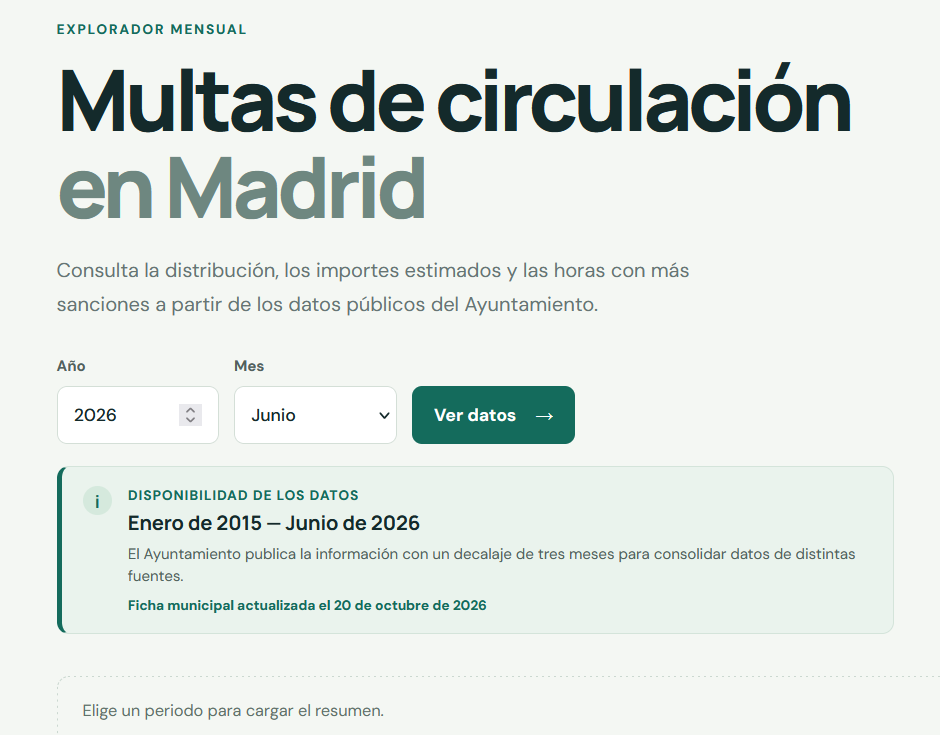
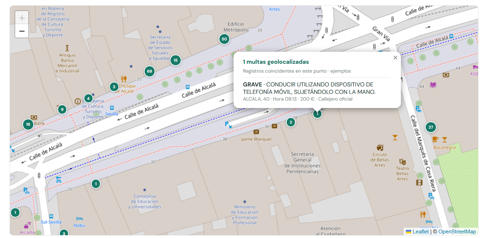

# Multas de tráfico de Madrid

Proyecto iniciado como práctica de **Python para Desarrolladores** del Máster en Big Data & Data Engineering (UCM), ampliado como aplicación web para explorar datos abiertos del Ayuntamiento de Madrid.

## Capturas

<table>
  <tr>
    <td width="50%" align="center">
      <a href="./screenshots/inicio.png" target="_blank" rel="noopener noreferrer"></a><br>
      <sub>Portada y cobertura disponible</sub>
    </td>
    <td width="50%" align="center">
      <a href="./screenshots/resumen-periodo.png" target="_blank" rel="noopener noreferrer"></a><br>
      <sub>Resumen mensual y gráficos</sub>
    </td>
  </tr>
  <tr>
    <td width="50%" align="center">
      <a href="./screenshots/mapa-general.png" target="_blank" rel="noopener noreferrer"></a><br>
      <sub>Distribución geográfica</sub>
    </td>
    <td width="50%" align="center">
      <a href="./screenshots/multa-detalle.png" target="_blank" rel="noopener noreferrer"></a><br>
      <sub>Detalle de una ubicación</sub>
    </td>
  </tr>
</table>

## Aplicación web

Dashboard mensual con resumen de multas, importes estimados, distribución por calificación, actividad por hora y mapa de ubicaciones geolocalizadas. El mapa muestra registros cuya calle y número coinciden con un portal del callejero oficial.

La fuente publica los datos con un decalaje de tres meses para consolidar información de distintas fuentes. El formulario muestra la cobertura consultada y avisa si el periodo elegido aún no está publicado.

## Estructura del proyecto

```text
.
├── src/traficfines/
│   ├── madridFines.py       # Descarga, limpieza y análisis mensual de multas.
│   ├── cache.py             # Caché local de datos y descargas.
│   └── __init__.py          # Interfaz pública del paquete.
├── webapp/
│   ├── server.py            # Servidor local y API para resumen, cobertura y mapa.
│   └── static/
│       ├── index.html       # Página del dashboard.
│       ├── app.js           # Gráficos, filtros y mapa interactivo.
│       ├── styles.css       # Estilos adaptables a móvil y escritorio.
│       └── favicon.svg      # Icono del sitio.
├── tests/
│   ├── test_cache.py        # Pruebas de la caché.
│   ├── test_madrid_fines.py # Pruebas del paquete de análisis.
│   ├── test_webapp.py       # Pruebas de cobertura, periodos y errores web.
│   └── data/                # Datos temporales aislados para las pruebas.
├── notebooks/
│   ├── enunciado.ipynb      # Enunciado original de la práctica.
│   ├── etapa1.ipynb         # Exploración y análisis inicial.
│   └── etapa2.ipynb         # Validación y uso del paquete.
├── screenshots/             # Capturas de la aplicación incluidas en este README.
├── pyproject.toml           # Dependencias y configuración del proyecto.
└── uv.lock                  # Versiones bloqueadas para reproducir el entorno.
```

## Ejecutar en local

Requiere [uv](https://docs.astral.sh/uv/). Desde la raíz del proyecto:

```bash
uv sync --no-dev
uv run python webapp/server.py
```

Abre `http://127.0.0.1:8000`. Para acceder desde otro dispositivo de la misma red, usa la IP local del equipo que ejecuta el servidor.

## Tests

```bash
uv run pytest --doctest-modules --cov=traficfines --cov=webapp.server --cov-report=term-missing --cov-report=html
```

Los cuadernos de `notebooks/` son material complementario. Para abrirlos, instala Jupyter por separado o impórtalos en Google Colab o en tu IDE.

**Datos:** Portal de Datos Abiertos del Ayuntamiento de Madrid · Licencia [CC BY 4.0](https://creativecommons.org/licenses/by/4.0/).
