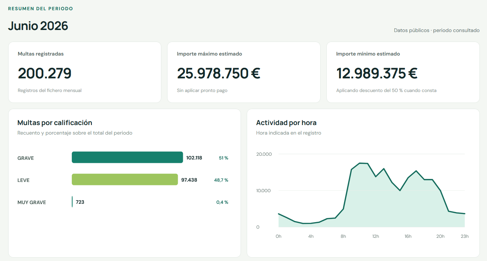
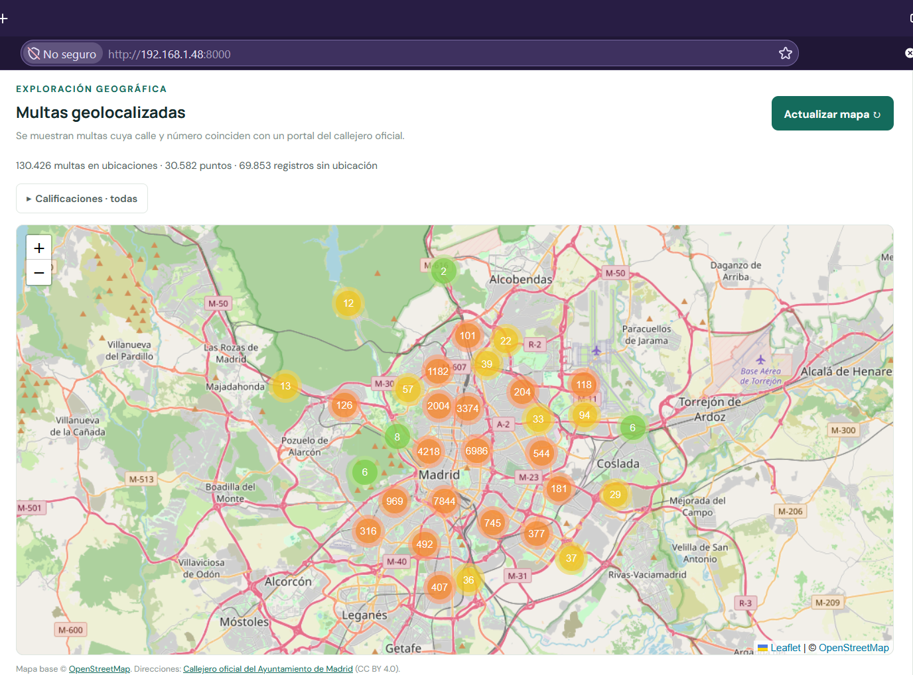

# Multas de tráfico de Madrid

Proyecto iniciado como práctica de _Python para Desarrolladores_ del **Máster en Big Data & Data Engineering (UCM)**, ampliado como aplicación web para explorar datos abiertos del Ayuntamiento de Madrid.

> **[Ver Demo Online](https://beetlebum97.github.io/madrid-traffic-fines)**  
> Muestra una versión estática interactiva con un periodo precargado. Para consultar cualquier mes desde enero de 2015, ejecuta la aplicación en local.

## Capturas

<table>
  <tr>
    <td width="50%" align="center">
      <a href="./screenshots/inicio.png" target="_blank" rel="noopener noreferrer"></a><br>
      <sub>Portada y cobertura disponible</sub>
    </td>
    <td width="50%" align="center">
      <a href="./screenshots/resumen-periodo.png" target="_blank" rel="noopener noreferrer"></a><br>
      <sub>Resumen mensual y gráficos</sub>
    </td>
  </tr>
  <tr>
    <td width="50%" align="center">
      <a href="./screenshots/mapa-general.png" target="_blank" rel="noopener noreferrer"></a><br>
      <sub>Distribución geográfica</sub>
    </td>
    <td width="50%" align="center">
      <a href="./screenshots/multa-detalle.png" target="_blank" rel="noopener noreferrer"></a><br>
      <sub>Detalle de una ubicación</sub>
    </td>
  </tr>
</table>

## Aplicación web

Dashboard mensual con resumen de multas, importes estimados, distribución por calificación, actividad por hora y mapa de ubicaciones geolocalizadas. El mapa muestra registros cuya calle y número coinciden con un portal del callejero oficial.

La fuente publica los datos con un decalaje de tres meses para consolidar información de distintas fuentes. El formulario muestra la cobertura consultada y avisa si el periodo elegido aún no está publicado.

## Estructura del proyecto

```text
.
├── docs/                    # Demo estática generada para GitHub Pages.
├── src/traficfines/
│   ├── madridFines.py       # Descarga, limpieza y análisis mensual de multas.
│   ├── cache.py             # Caché local de datos y descargas.
│   └── __init__.py          # Interfaz pública del paquete.
├── webapp/
│   ├── server.py            # Servidor local y API para resumen, cobertura y mapa.
│   ├── build_demo.py        # Genera la demo estática en docs/ para un mes concreto.
│   └── static/
│       ├── index.html       # Página del dashboard.
│       ├── app.js           # Gráficos, filtros y mapa interactivo.
│       ├── styles.css       # Estilos adaptables a móvil y escritorio.
│       └── favicon.svg      # Icono del sitio.
├── tests/
│   ├── test_cache.py        # Pruebas de la caché.
│   ├── test_madrid_fines.py # Pruebas del paquete de análisis.
│   ├── test_webapp.py       # Pruebas de cobertura, periodos y errores web.
│   └── data/                # Datos temporales aislados para las pruebas.
├── notebooks/
│   ├── enunciado.ipynb      # Enunciado original de la práctica.
│   ├── etapa1.ipynb         # Exploración y análisis inicial.
│   └── etapa2.ipynb         # Validación y uso del paquete.
├── screenshots/             # Capturas de la aplicación incluidas en este README.
├── pyproject.toml           # Dependencias y configuración del proyecto.
└── uv.lock                  # Versiones bloqueadas para reproducir el entorno.
```

## Ejecutar en local

Requiere [uv](https://docs.astral.sh/uv/). Desde la raíz del proyecto:

```bash
uv sync --no-dev
uv run webapp/server.py
```

Abre `http://127.0.0.1:8000`. Para acceder desde otro dispositivo de la misma red, introduce la direccion IP del servidor. `http://ip-servidor:8000`

## Regenerar la demo estática (GitHub Pages)

Para generar o actualizar la versión estática en `docs/` con el último mes publicado (o con un periodo específico):

```bash
uv run webapp/build_demo.py

# Periodo concreto:
uv run webapp/build_demo.py --year 2024 --month 12
```

Para previsualizar la demo estática en local sin levantar el servidor de backend:

```bash
uv run python -m http.server 8080 --directory docs
```

## Tests

```bash
uv run pytest --doctest-modules --cov=traficfines --cov=webapp.server --cov-report=term-missing --cov-report=html
```

## Ejemplo de uso del módulo`traficfines` y la clase `MadridFines`

```text
uv run python
Python 3.14.7 (tags/v3.14.7:823f032, Aug  5 2026, 10:51:32) [MSC v.1944 64 bit (AMD64)] on win32
Type "help", "copyright", "credits" or "license" for more information.
>>> from traficfines import MadridFines
>>> gestor = MadridFines(app_name="mi_analisis", obsolescence=7)
>>> gestor.add(2024, 12)
>>> gestor.add(2019, 5)
>>> print(gestor.fines_calification())
CALIFICACION   GRAVE    LEVE  MUY GRAVE
MES ANIO
5   2019       61124  111017        747
12  2024      157605   91388        808
>>> print(gestor.total_payment())
             IMP_MAX     IMP_MIN
MES ANIO
5   2019  17207760.0   8603880.0
12  2024  37005230.0  18502615.0
>>> gestor.fines_hour("evolucion_multas.png")
>>> exit
```

Los cuadernos de `notebooks/` son material complementario. Para abrirlos, instala Jupyter o impórtalos en Google Colab o en tu IDE.

**Datos:** Portal de Datos Abiertos del Ayuntamiento de Madrid · Licencia [CC BY 4.0](https://creativecommons.org/licenses/by/4.0/).